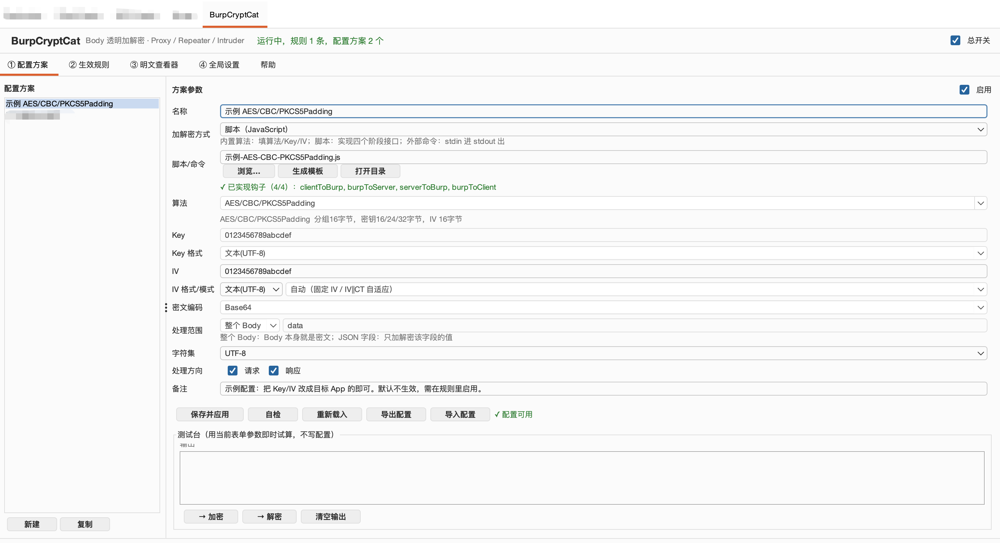

# BurpCryptCat 🐱

> 一只蹲在 Burp 里的猫：**帮你把加密的请求/响应 Body 自动翻译成明文**，
> 你照常改包、爆破、扫洞，它负责在你发包前、回包后把密文加回去。

<p>
  
  
  
  
  
</p>

```text
客户端 ──密文──► Burp ──[解密]──► 明文（你能读、能改、能扫）
客户端 ◄─密文── Burp ◄─[加密]──  密文（客户端/服务端照常工作）
```

支持三种加解密方式：**内置算法**（AES/SM4 + Key/IV）、**JavaScript 脚本**（四个阶段接口）、
**外部命令**（Python/Node/任何 CLI，stdin 进 stdout 出）。

---

## 目录

- [30 秒上手](#30-秒上手)
- [它到底做了什么](#它到底做了什么)
- [三种加解密方式](#三种加解密方式)
- [四个脚本接口（重点）](#四个脚本接口重点)
- [常见场景怎么配](#常见场景怎么配)
- [配置存在哪](#配置存在哪)
- [一个绕不开的限制](#一个绕不开的限制)
- [原理速览](#原理速览)
- [自己编译](#自己编译)
- [FAQ / 排错](#faq--排错)
- [致谢](#致谢)

---

## 30 秒上手

```bash
# 1) 编译（只需 JDK 17+ 和本机 Burp，不联网）
./build.sh --tests

# 2) Burp → Extensions → Installed → Add → Java → 选 build/BurpCryptCat-<版本>.jar
```

然后在 Burp 里点三下：

| 步骤 | 做什么 |
|---|---|
| **① 配置方案** | 选算法（如 `AES/CBC/PKCS5Padding`）、填 Key / IV、选密文编码（Base64/HEX/原始）→ **保存并应用** |
| **② 生效规则** | 新增规则：匹配方式选 `Host`（`api.example.com` / `*.example.com`）或 `URL 通配` → 选方案 → 勾 **启用** |
| **③ 正常抓包** | Repeater 里改成明文发送，响应自动解密；Intruder 对明文爆破 |

不确定 Key/IV 对不对？把一段真实密文粘进「配置方案」右下角的**测试台**，点「→ 解密」立刻见分晓。

---

## 它到底做了什么

| 位置 | BurpCryptCat 的动作 |
|---|---|
| **Proxy 请求** | 客户端发来的密文 → 解密（Burp 里是明文）→ 放行前自动加密 → 服务端收到密文 |
| **Proxy 响应** | 服务端返回的密文 → 解密 → 回写客户端前自动加密 → 客户端照常工作 |
| **Repeater** | 编辑器里是明文；点 Send 前整包加密；响应自动解密后展示 |
| **Intruder** | 对明文插 Payload，**每个变异包单独加密**；响应自动解密 |
| **Scanner / 其它插件** | 顶层开关打开后一并生效（请求加密、响应解密） |
| **右键菜单** | 复制明文请求（完整报文）· 查看明文 · 解密后发送到 Repeater / Intruder |
| **明文页签** | 每条命中规则的报文多一个「BurpCryptCat 明文」页签：**完整报文**（请求行 + 全部 Header + 解密 Body），JSON 自动缩进 |

只改 **Body**。URL、Header、Cookie 一个字节不动，`Content-Length` 由 Burp 自己维护。

---

## 三种加解密方式

「① 配置方案 → 加解密方式」里三选一：

| 方式 | 适合谁 | 怎么用 |
|---|---|---|
| **内置算法** | 标准 `AES/CBC/PKCS5Padding + Key + IV` | 填字段，选编码，选 IV 模式（固定 / 随机 IV 前置 / **自动**） |
| **脚本（JavaScript）** | 逻辑不规整：时间戳参与、报文套层、IV 在 Header、要拼现成算法 | 写一个 `.js`，实现四个函数；插件按阶段调用（内置 Rhino，无需装东西） |
| **外部命令** | 想用 Python / Node / 团队现成 CLI | 填一行命令：Body 走 stdin，新 Body 走 stdout |

**支持的内置算法**：AES（ECB/CBC/CFB/OFB/CTR/GCM）、DES、3DES、**SM4**（内置实现，不依赖 BouncyCastle）、
RC4、ChaCha20；填充 PKCS5(7)/NoPadding/ZeroPadding/ISO10126；也能手打任意 JCE transformation。

<details>
<summary><b>两种 IV 形态怎么选</b></summary>

| 形态 | 报文长什么样 | 怎么配 |
|---|---|---|
| 固定 IV | 每次密文一样（同明文） | IV 填死，模式 **固定** |
| `IV‖CT` | 每包密文都不一样，前 16 字节是随机 IV | IV 留空，模式 **自动**（或「随机 IV 前置」） |

「自动」= 先按固定 IV 解，解不出可读文本再按「前 16 字节 = IV」解，两边都失败才报错。

</details>



---

## 四个脚本接口（重点）

Burp 的 Proxy 有四个关键时刻，脚本各对应一个函数：

```js
// ① 客户端 → Burp      刚收到请求时（一般：解密，让 Burp 里看到明文）
function clientToBurp(ctx) { return crypto.aesCbcDecrypt(KEY, IV, ctx.body); }

// ② Burp → 服务端       请求放行前（一般：加密，让服务端收到密文）
function burpToServer(ctx) { return crypto.aesCbcEncrypt(KEY, IV, ctx.body); }

// ③ 服务端 → Burp       刚收到响应（一般：解密）
function serverToBurp(ctx) { return crypto.aesCbcDecrypt(KEY, IV, ctx.body); }

// ④ Burp → 客户端       响应回写前（一般：加密，让客户端照常工作）
function burpToClient(ctx) { return crypto.aesCbcEncrypt(KEY, IV, ctx.body); }
```

**只写需要的**，没实现的阶段自动跳过（只写 ①②，响应方向就完全不动）。

`ctx` 里能拿到：

| 字段 | 说明 |
|---|---|
| `ctx.body` | 当前 Body 文本（按方案字符集解码） |
| `ctx.header("x-iv")` / `ctx.headers` | 取某个 Header / 全部 Header（大小写不敏感） |
| `ctx.url` `ctx.method` `ctx.isRequest` | 请求信息 |
| `ctx.stage` / `stageCode` | 当前阶段（1~4） |
| `ctx.log("...")` | 打到 Extender → Output |

返回值：**字符串** = 新 Body；**`null`** = 不改动；`{body:"..."}` 也行。
脚本报错 / 超时 / 返回空 → **一律保持原样**并记一条错误，不会卡住 Burp。

现成工具 `crypto.*`：`b64Encode/b64Decode`、`hexEncode/hexDecode`、`md5/sha256`、
`aesCbcEncrypt(key,iv,plain)`、`aesCbcDecrypt(key,iv,ct)`、`aesCbcDecryptPrependIv(key,ct)`。

<details>
<summary><b>点开看：小程序「IV 在密文前 16 字节」的完整脚本</b></summary>

```js
var KEY = "ysIEuRgXG/SMp4HqZL1BEw=";   // Base64 的 AES Key

// ① 收到请求：密文前 16 字节就是随机 IV
function clientToBurp(ctx) {
    var plain = crypto.aesCbcDecryptPrependIv(KEY, ctx.body);
    ctx.log("请求解密：" + (plain === null ? "失败" : "成功"));
    return plain;                       // null 表示不改动
}

// ② 放行前：用固定 IV 加密（服务端只认这个写法）
function burpToServer(ctx) {
    return crypto.aesCbcEncrypt(KEY, "63cef27c4a68b8f4", ctx.body);
}

// ③④ 响应方向不处理 → 这两个函数不写即可
```

</details>

<details>
<summary><b>点开看：外部命令（Python）怎么写</b></summary>

配置里填：`python3 ~/.BurpCrypto/scripts/gm.py`

```python
import sys, base64
from Crypto.Cipher import AES

KEY = base64.b64decode("ysIEuRgXG/SMp4HqZL1BEw=")
raw = base64.b64decode(sys.stdin.buffer.read())      # stdin = 原始 Body
iv, ct = raw[:16], raw[16:]
pt = AES.new(KEY, AES.MODE_CBC, iv).decrypt(ct)
sys.stdout.buffer.write(pt[:-pt[-1]])                # stdout = 新 Body
```

环境变量可用：`BC_STAGE`(1~4) / `BC_URL` / `BC_METHOD` / `BC_IS_REQUEST` / `BC_CHARSET`。
退出码非 0 或超时（默认 5s）→ 不改动并报错。

</details>

**上手**：「加解密方式」选 **脚本(JavaScript)** → 点 **生成模板**（在 `~/.BurpCrypto/scripts/` 生成带四接口和注释的 `.js`）
→ 改 Key/IV、删掉不用的接口 → 点 **自检**，下面会显示 **已实现钩子（n/4）** → 测试台验证。

> ⚠️ 脚本拥有与 Burp 相同的权限（未做沙箱），只运行你信任的脚本。

---

## 常见场景怎么配

**① 标准 AES 接口**

| 字段 | 值 |
|---|---|
| 算法 | `AES/CBC/PKCS5Padding` |
| Key / 格式 | `0123456789abcdef` / 文本(UTF-8) |
| IV / 模式 | `0123456789abcdef` / 自动 |
| 密文编码 | Base64 |

**② 每包随机 IV（`base64(IV‖CT)`）——小程序最常见**

IV **留空**、IV 模式选 **自动**。用固定 IV 去解只会让"前 16 字节乱码、后面正常"（CBC 的 IV 只影响第一个分组）。

**③ 密文藏在 JSON 字段里**

```json
{"code":0,"data":"9f8e7d...","msg":"ok"}
```

处理范围选 **JSON 字段**，字段名填 `data`；其余字段、缩进、键顺序原样保留。

**④ 逻辑太怪，内置算法搞不定**

「加解密方式」换成 **脚本** 或 **外部命令**，见上一节。

---

## 配置存在哪

```text
~/.BurpCrypto/                 ← 目录名沿用旧版，升级不丢配置
├── config                     ← 配置本体（INI：方案 + 规则 + 全局开关）
├── config.bak                 ← 上次保存的备份
├── status.txt                 ← 当前生效状态（开关/规则/自检，不含 Key）
└── scripts/                   ← （可选）JS 脚本
```

* 原子写 + 自动备份，Burp 崩了不会写坏；POSIX 上目录 `700`、文件 `600`
* 「④ 全局设置」里可以**换目录**、**重新载入**、**打开目录**
* 换目录、重装扩展、重启 Burp 都不会丢配置

---

## 一个绕不开的限制

Burp 的 Proxy **历史保存的就是"最终上线/回写的那份报文"**，所以：

* 想让历史显示明文 → 客户端/服务端**必然**收到明文
* 想让两端保持密文 → 历史里**必然**是密文

默认选后者（不破坏目标程序），明文通过 **「BurpCryptCat 明文」页签 / 明文查看器 / 右键发到 Repeater** 看。
真要"历史明文"，到「④ 全局设置」把对应方向的「重新加密」勾掉即可。

---

## 原理速览

**明密文怎么判？** 试探性解密：能解出可读文本 → 认为是密文，否则认为是明文。
所以同一报文被反复处理（Proxy 收到 → 放行 → Repeater 重发）**不会被加密两次**；
解不开的一律原样放行，绝不把流量搞坏。

**Proxy 两段式**：收到时解密并"记账"（`HandoffCache` 按 `方向+URL+明文哈希`），
只有**我们解出来的明文**才会在放行前被重新加密 —— 同域下本来不加密的页面不会被误加密。

更细的实现（包结构、算法层、阶段映射、脚本执行器）见 [docs/ARCHITECTURE.md](docs/ARCHITECTURE.md)；
真机验证记录见 [docs/VERIFICATION.md](docs/VERIFICATION.md)。

---

## 自己编译

```bash
./build.sh              # 编译 + 打包 → build/BurpCryptCat-<版本>.jar
./build.sh --tests      # 附 164 项单元测试
./build.sh --clean      # 清理
BURP_JAR=/path/to/burpsuite_pro.jar ./build.sh   # 指定 Burp jar
```

* 只依赖 **JDK 17+** 与本机 Burp（Montoya API 在 Burp 的 jar 里），不联网
* 脚本引擎 Rhino（`lib/rhino-1.7.15.jar`）会被打进 jar，用户只需装一个文件
* 单测覆盖：SM4 国标向量、与 `openssl` 逐字节对照、Key/IV 自动识别歧义、规则匹配、
  幂等与容错、完整报文渲染、JSON 美化、配置文件原子写、**脚本四个钩子 / 外部命令 / 异常不改动**

端到端脚本（需要真 Burp 在跑）：

```bash
python3 tools/test_server.py 9099    # 本地加密靶站
python3 tools/e2e_proxy.py           # 走代理打靶站，校验"两端密文 + 明文可见"
```

---

## FAQ / 排错

| 现象 | 原因 / 处理 |
|---|---|
| 什么都不发生 | 看插件顶部状态栏：「总开关 / 规则 / 方案」任一没启用都会写出来 |
| 日志里 `填充错误` | Key、IV、算法、编码有一项不对；用测试台核对 |
| **只有前 16 字节乱码，后面正常** | 密文是 `IV‖CT`，IV 模式改成 **自动** |
| 解出来是乱码但能解开 | 编码选错了（Base64/HEX），或明文其实是 GBK —— 改「字符集」 |
| Repeater 发出去还是明文 | 该 URL 没命中规则，或方案被禁用 |
| Proxy 历史里没有明文 | 见[上面的限制](#一个绕不开的限制)，用页签/查看器看 |
| 脚本方式"没生效" | 看「脚本/命令」下面那行：`已实现钩子(n/4)`，n=0 说明没编译通过或函数名写错 |
| 外部命令很慢 | 每个报文都会跑一次进程；重逻辑（加载大模型之类）别放这里，改用 JS |
| 想确认配置在哪                   | 「④ 全局设置」第一行，或看 `~/.BurpCrypto/status.txt`        |
|                                  |                                                              |

**边界**：SM4 目标用内置算法；插件不重算签名头（`X-Signature` 之类要另外处理）；
自己开 socket 直连目标的插件，Burp 看不到，任何扩展都插不进去。

---

## 致谢

* 产品思路源自 [whwlsfb/BurpCrypto](https://github.com/whwlsfb/BurpCrypto)，本项目的配置模型与透明加解密逻辑为**重写**
* 透明加解密的处理器编排参考了 autoDecoder 等项目的实践
* MIT License，见 [LICENSE](LICENSE)
