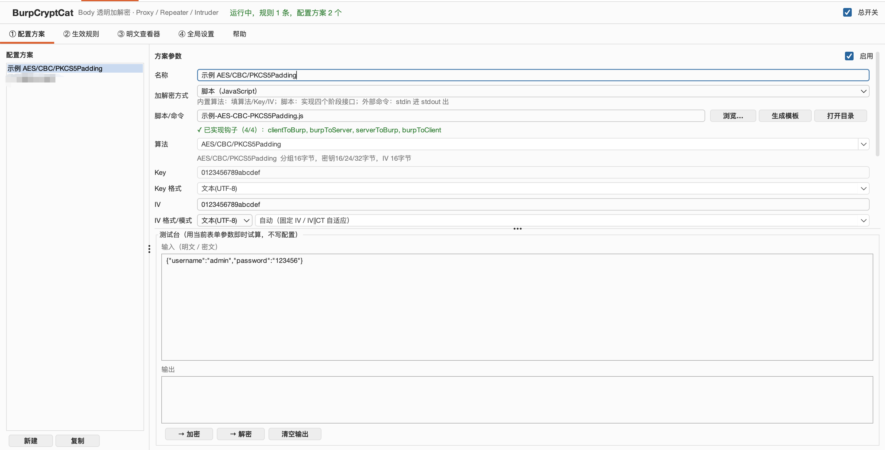
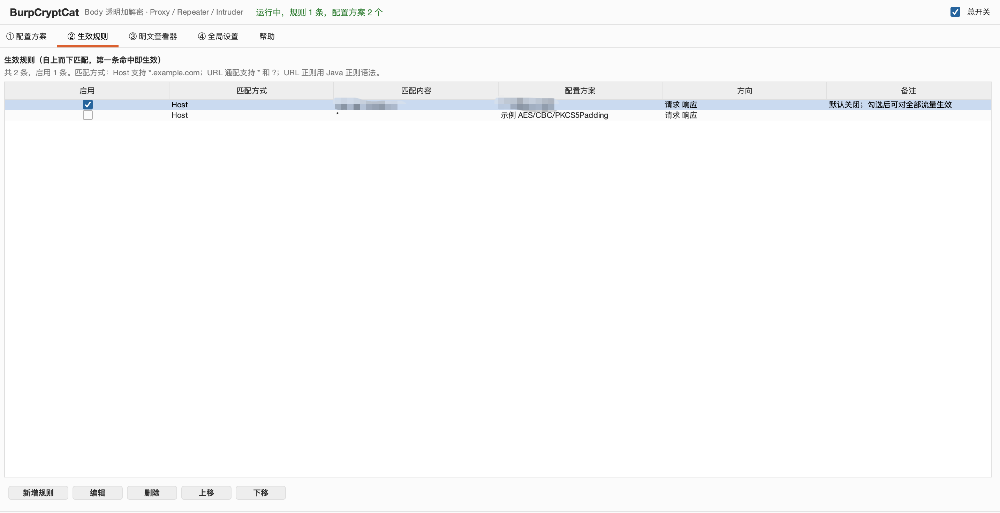
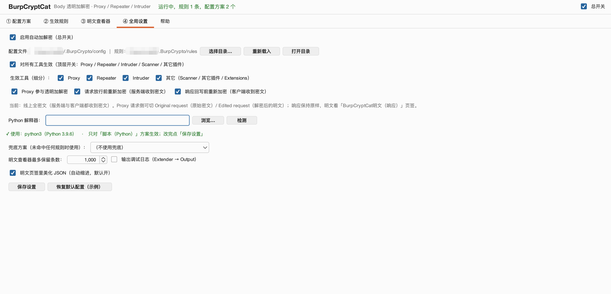

# BurpCryptCat 🐱

> 自动把请求/响应 Body 里的密文翻译成明文

<p>
  
  
  
  
  
</p>

```text
客户端 ──密文──► Burp ──[解密]──► 明文（能读、能改、能扫）
客户端 ◄─密文── Burp ◄─[加密]──  密文（客户端 / 服务端照常工作）
```


---

**基于BurpCrypto二开，原项目地址：https://github.com/whwlsfb/BurpCrypto/**

---


默认内置 key只动 **Body**：URL、Header、Cookie 一个字节不改。支持四种加解密方式 ——

**内置算法**（AES / SM4 / DES / 3DES / RC4 / ChaCha20）

**JavaScript 脚本**

**Python 脚本**、**外部命令**（stdin 进、stdout 出）

---

## 插件分4 个模块

### 1、配置方案

 **算法 + Key + IV + 密文编码 + Body 处理范围 + 字符集**。

- **加解密方式**四选一：内置算法、脚本(JavaScript)、脚本(Python)、外部命令（stdin/stdout）；

- **算法**：AES（ECB/CBC/CFB/OFB/CTR/GCM）、SM4（内置实现，不依赖 BouncyCastle）、DES、3DES、
  RC4、ChaCha20；也能手打任意 JCE transformation；
  
- **Key / IV** 支持自动识别（文本 / HEX / Base64）；IV 模式有
  **固定 IV**、**随机 IV 前置（IV‖CT）**、**自动**（先固定再 IV‖CT）、**无 IV**；
  
- **密文编码**：Base64 / HEX / 原始二进制；**处理范围**：整个 Body / JSON 字段（字段名可指定）；

- **测试台**：粘一段真实密文点「→ 解密」，马上验证 Key/IV/算法对不对；

- **自检**、**导出配置 / 导入配置**、**生成脚本模板**一键可达。

  



### 2、生效规则

决定"哪些流量走哪条方案"，避免把同域下本来不加密的页面搞坏。

- 匹配方式：**Host**（支持 `*.example.com` 通配）、**URL 通配**（`*` `?`）、**URL 正则**；
- 每条规则可选作用方向（请求 / 响应）、是否启用，按列表顺序从上到下**第一条命中生效**；
- 没命中任何规则时可指定**兜底方案**；
- 规则单独存成 `~/.BurpCrypto/rules`。





### 3、明文查看器

加解密的**实时流水**

- 一行一条：来源工具、阶段（请求解密 / 请求加密 / 响应解密 / 响应加密）、方法、Host、URL、明文预览
- 支持**过滤**、只**看解密**、**刷新**、**清空**、**详情**
- 不写 Key/IV 内容，配置目录里另有 `status.txt` 记录当前生效状态


### 4、全局设置

所有方案的公共开关

- **总开关**（顶部标题栏也有）、**生效工具**：Proxy / Repeater / Intruder / Scanner / 其它插件；
- **Proxy**：参与开关、**请求放行前重新加密**、**响应回写前重新加密**；
- 明文页签里 **美化 JSON**、**调试日志**、明文流水保留条数；
- **Python 解释器**（留空自动探测 `python3` → `python`，可填绝对路径 / venv）；
- **兜底方案**、**配置目录**（选择 / 重新载入 / 打开目录）、恢复默认配置。





### 5、帮助

内置离线帮助页：三步开始用、每个位置发生什么、为什么 Proxy 历史默认是密文、
脚本四个接口、常见配置对应关系、判定逻辑、支持的算法、排错清单、安全提醒。
不联网也能查，界面里随时打开。

---

## 它到底做了什么

| 位置 | 动作 |
|---|---|
| **Proxy 请求** | 收到密文 → 解密后交给 Burp（Original request = 原始密文 / Edited request = 解密明文）→ 真正上线前加密回密文 |
| **Proxy 响应** | 报文不动，Burp 里就是服务端原始响应；明文在「BurpCryptCat明文（响应）」页签里看 |
| **Repeater** | 编辑器里是明文，点 Send 前整包加密；响应自动解密展示 |
| **Intruder** | 对明文插 Payload，每个变异包单独加密；响应自动解密 |
| **Scanner / 其它插件** | 打开顶层开关后一并生效（请求加密、响应解密） |
| **右键菜单** | 复制明文请求（完整报文）· 查看明文 · 解密后发送到 Repeater / Intruder |
| **明文页签** | 命中规则的报文多一个「BurpCryptCat明文」页签：完整报文 + JSON 自动缩进，可直接编辑 |

---

## 安装

```bash
# 1) 编译（只需 JDK 17+、本机 Burp，不联网）
./build.sh --tests

# 2) Burp → Extensions → Installed → Add → Java
#    选 build/BurpCryptCat-<版本>.jar
```

> 加载后到 BurpCryptCat 页签；配置存在 `~/.BurpCrypto/`，升级扩展不会丢。

---


📖 **完整文档（原理、Burp 各工具用法、脚本/外部命令接口与示例、其它插件怎么接入）请见 Wiki：**

**<https://github.com/Superman-L/BurpCryptCat/wiki/BurpCryptCat-wiki>**
